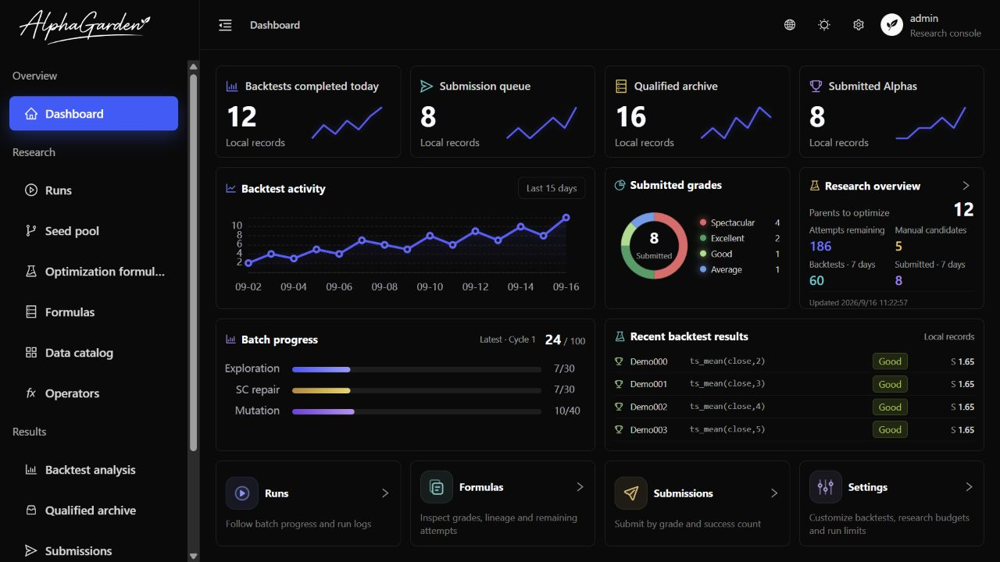
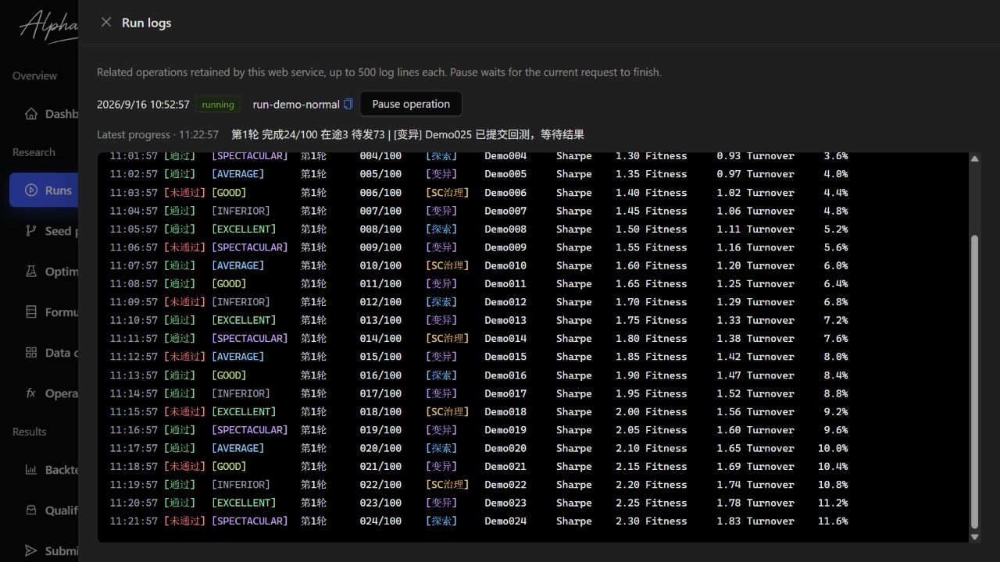
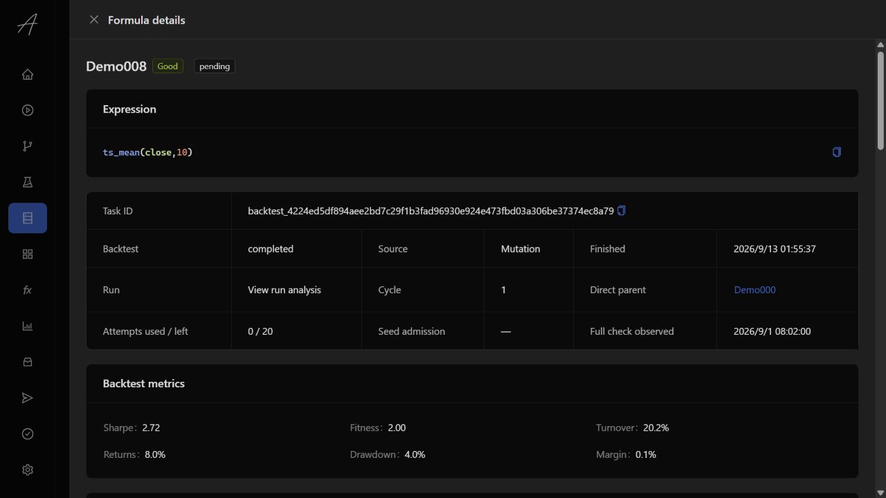
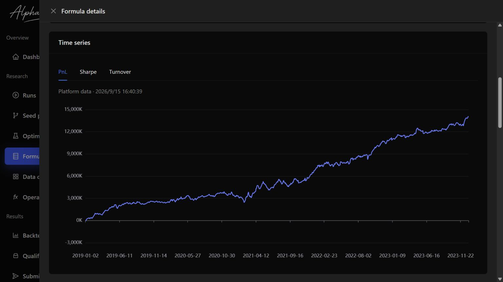
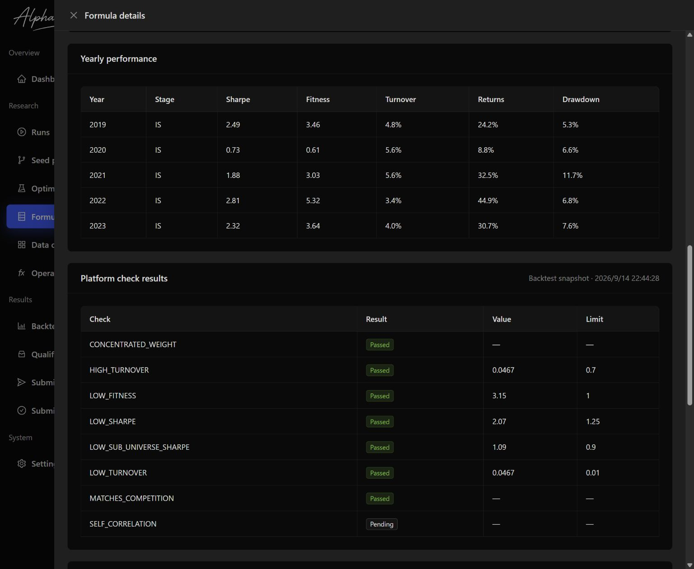
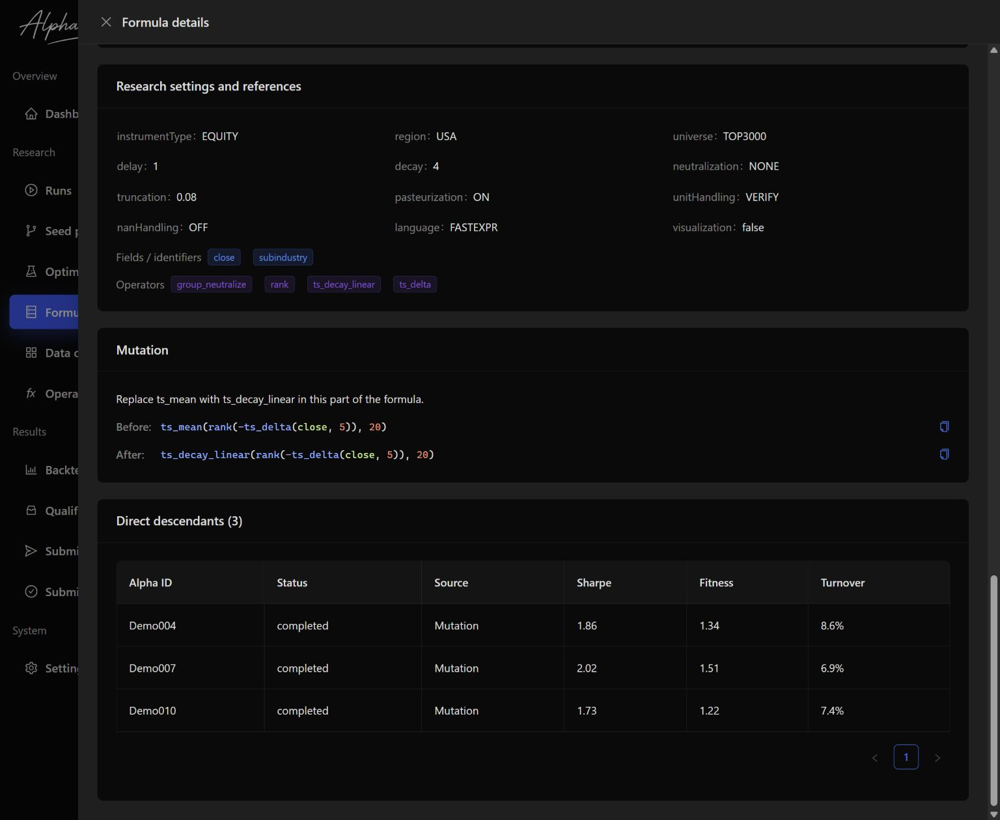
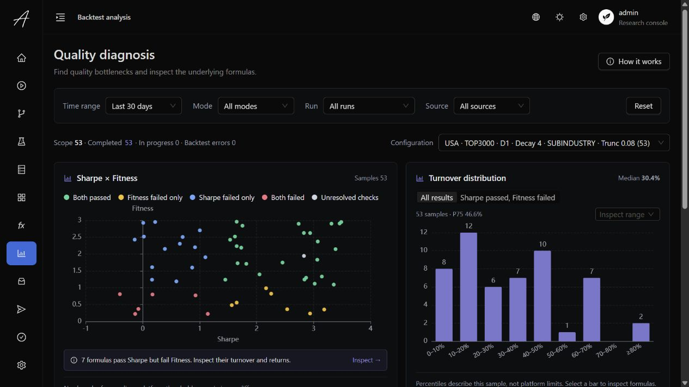
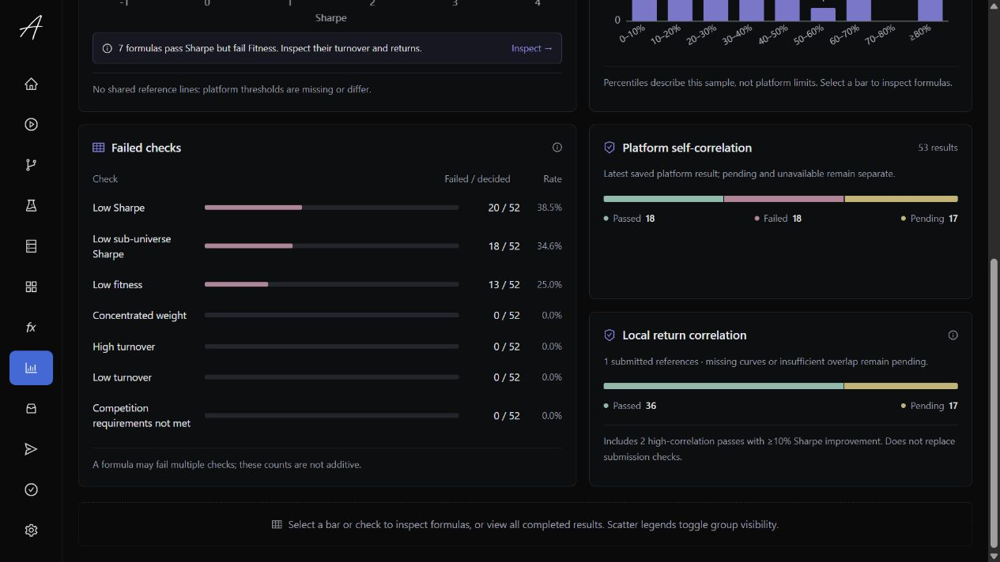
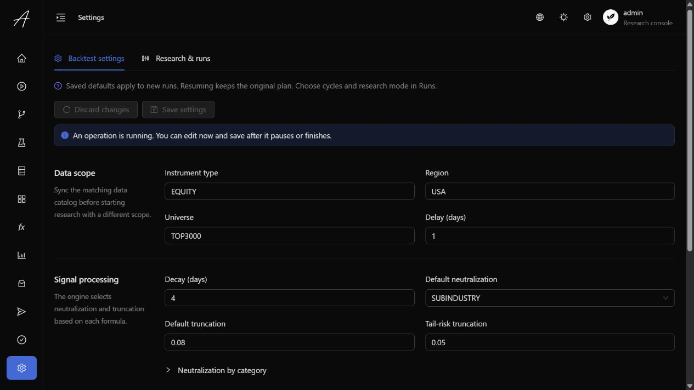

# Alpha Garden

**Grow formulas into research you can inspect, improve, and build on.**

**English** · [简体中文](README.zh-CN.md)

Alpha Garden is a local research workspace for **WorldQuant BRAIN**. A Python engine explores, mutates, backtests and checks formulas in bulk; a bilingual web console lets you watch and steer it. You set the budget and limits, and the system keeps producing formulas unattended, with a strong focus on controlling self-correlation (SC) and submitting the highest-graded results first.

**Python · React · TypeScript · Ant Design · ECharts · SQLite**

[Features](#features) · [Quick start](#quick-start) · [How research works](#how-research-works) · [Commands](#commands) · [Development](#development) · [More docs](#more-docs)



> The time-series and yearly/check screenshots use authorized, saved platform backtest data with formula identifiers omitted. Expressions, lineage and logs on other screens are synthetic examples.

## Features

| Workspace | What you can do |
| --- | --- |
| **Dashboard** | 15-day backtest activity, grade distribution, remaining optimization attempts, batch progress. |
| **Runs** | Start normal research or focused optimization, set cycles, follow live logs, pause and resume. |
| **Seed pool & optimization** | Browse seeds and research branches, lineage and remaining mutation attempts. |
| **Formulas** | Search backtested formulas, grades and checks, and open details. |
| **Backtest analysis** | Diagnose Sharpe / Fitness, turnover, failed checks and correlation. |
| **Qualified archive & submissions** | Submit one at a time, by grade, or "All grades, best first". |
| **Data catalog & operators** | Search synchronized fields and operators. |
| **Settings** | Edit backtest defaults, research allocation, budgets, concurrency and failure limits. |

<details>
<summary>More screenshots</summary>










</details>

## Quick start

You need **Python 3.11+**, **Node.js 24 + pnpm 11** and a **WorldQuant BRAIN account**. Run the commands below in PowerShell from the repository root.

**1. Install and configure**

```powershell
python -m pip install --no-deps -e .
if (-not (Test-Path .env)) { Copy-Item .env.example .env }
```

Fill in `WQB_ACCOUNT_SCOPE` and your credentials following [.env.example](.env.example). Never commit credentials. Defaults live in [config/](config/).

**2. Initialize and sync submitted alphas**

```powershell
alpha-garden init             # create the database, sync fields and operators (resumable)
alpha-garden sync-submitted   # baseline of submitted alphas and PnL; SC checks rely on it
```

**3. Build and open the console**

```powershell
pnpm --dir webui install --frozen-lockfile
pnpm --dir webui build
alpha-garden web              # add --read-only to only view data
```

Open <http://127.0.0.1:8787> and sign in with the local console account `admin` / `123123` (unrelated to your WorldQuant account; loopback only).

**4. Start researching**

Check budgets in **Settings** → start normal research or focused optimization in **Runs** → inspect results in **Formulas / Backtest analysis** → submit from **Qualified archive & submissions**. Runs started from the web **never submit automatically**. Closing the browser does not stop a run; use Pause to stop at a safe boundary and Resume later.

## How research works

```text
Explore (idea templates + random) → qualified formulas become seeds → mutations / combo enhancement
→ focused optimization → local queue checks → submit best grade first (platform re-check before submitting)
```

- **Exploration**: most exploration slots come from 27 idea templates in 7 families; the rest are random.
- **Seeds and lineages**: independent qualified formulas become seeds and are researched along their lineage. Each formula has up to 20 mutation attempts; each root lineage has up to 80 quality-research backtests.
- **Mutation and diagnosis**: the parent's weak spot (turnover, returns, Sharpe) picks which mutations to try first.
- **Combo enhancement**: a qualified parent is combined with a low-correlation companion signal at the Sharpe-optimal weight.
- **SC control**: seed admission, companion choice, queue checks and submissions all compare locally with the platform rule (correlation ≥0.7 fails unless Sharpe is at least 10% higher).
- **Submission**: ordered by grade → Fitness → Sharpe; only the peak formula of each lineage is submitted.

Full details: [Research rules](docs/research-rules.md).

## Commands

| Action | Command |
| --- | --- |
| One cycle / five cycles | `alpha-garden run` / `alpha-garden run 5` |
| Focused optimization | `alpha-garden run -opt` |
| Resume a run | `alpha-garden resume <run_id>` |
| Submit two from the Spectacular queue | `alpha-garden submit 2` |
| Submit two of a grade | `alpha-garden submit good 2` |
| Sync submitted alphas and PnL | `alpha-garden sync-submitted` |
| Refresh operators only | `alpha-garden sync-operators` |
| Research feedback for a run | `alpha-garden research-status <run_id>` |
| Local storage usage | `alpha-garden storage inspect` |
| Open the console | `alpha-garden web` |

SC-directed research, database upgrades, rate limits and the storage retention preview are covered in the [Operations guide](docs/operations.md).

## Development

Research data lives in `data/alpha_garden.sqlite3` and account settings in `.env`. Credentials, databases, logs and the submitted-formula list are kept out of Git.

| Content | Location |
| --- | --- |
| Research engine, platform client, web API | [src/](src/) |
| React frontend | [webui/](webui/README.md) |
| Default configuration | [config/](config/) |
| Tests | [tests/](tests/) |

For frontend work, use two terminals:

```powershell
alpha-garden web --read-only   # terminal 1
pnpm --dir webui dev           # terminal 2, then open http://127.0.0.1:5173
```

## More docs

- [Research rules](docs/research-rules.md): exploration, seeds, mutations, combo enhancement, SC control and submission order.
- [Operations guide](docs/operations.md): catalog sync, runs and recovery, SC-directed research, database upgrades, rate limits and storage.
- [Architecture](docs/architecture.md): module responsibilities, main flow and data ownership.
- [Frontend development](webui/README.md)

## License

[MIT](LICENSE). Provided as is, without a commitment to ongoing maintenance or support.
