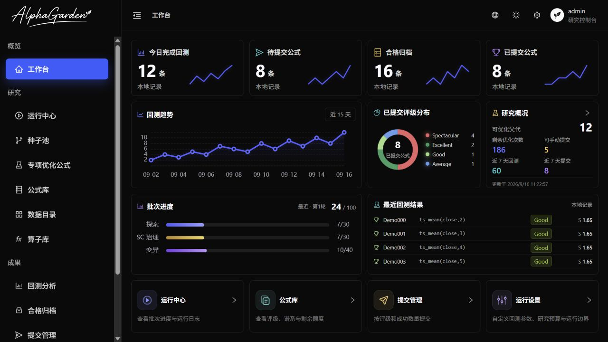
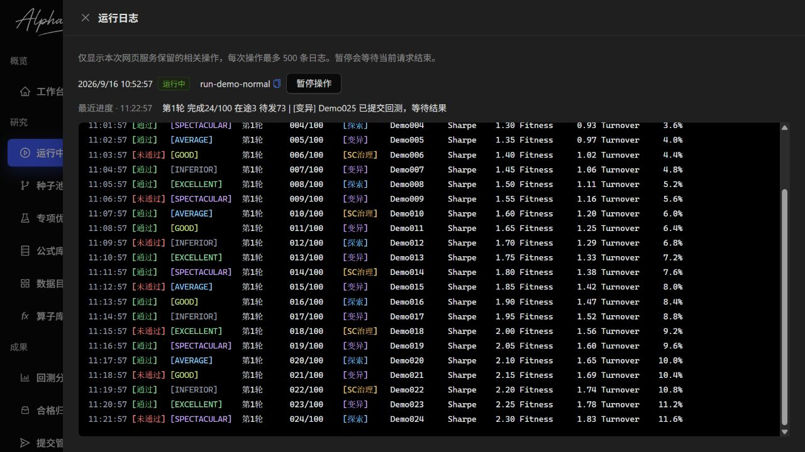
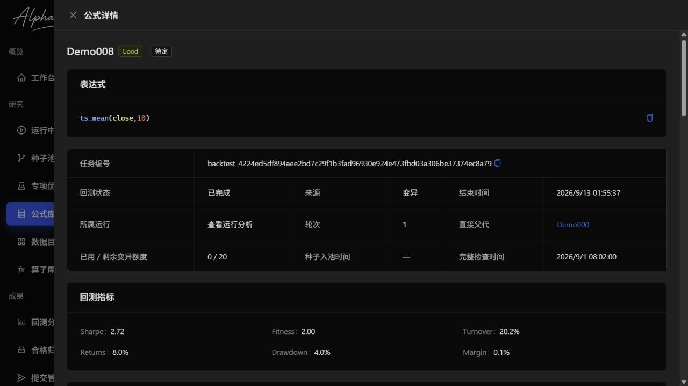
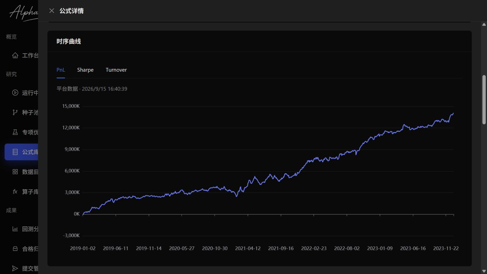
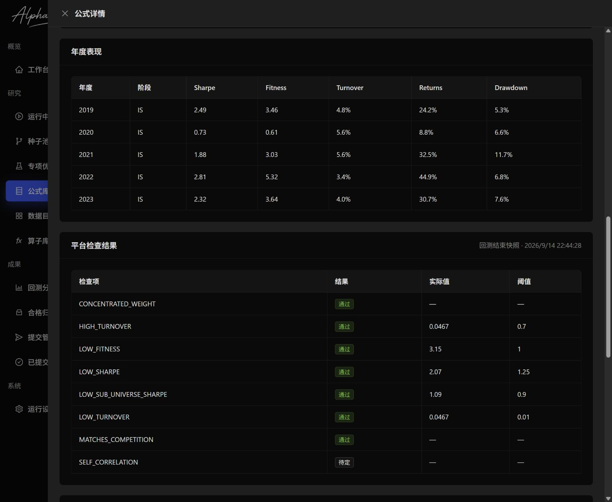
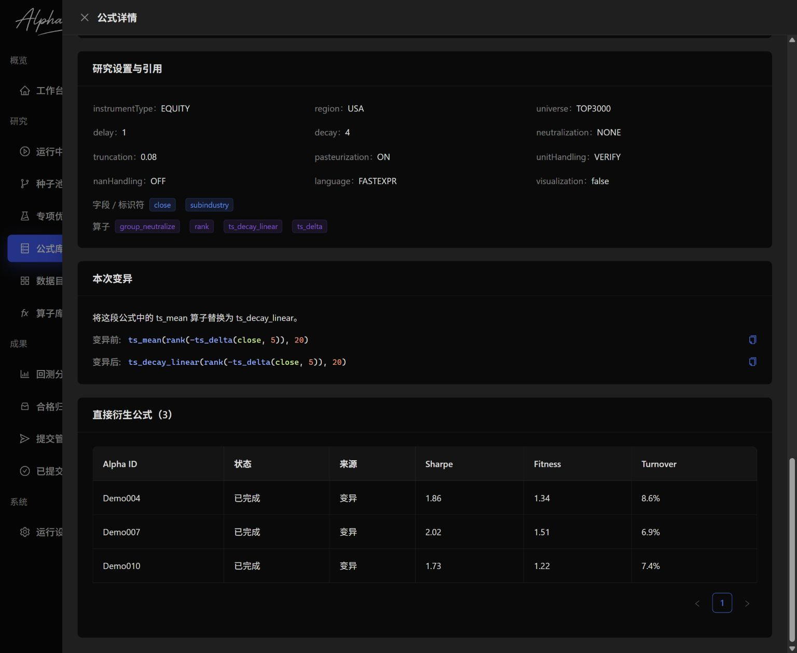
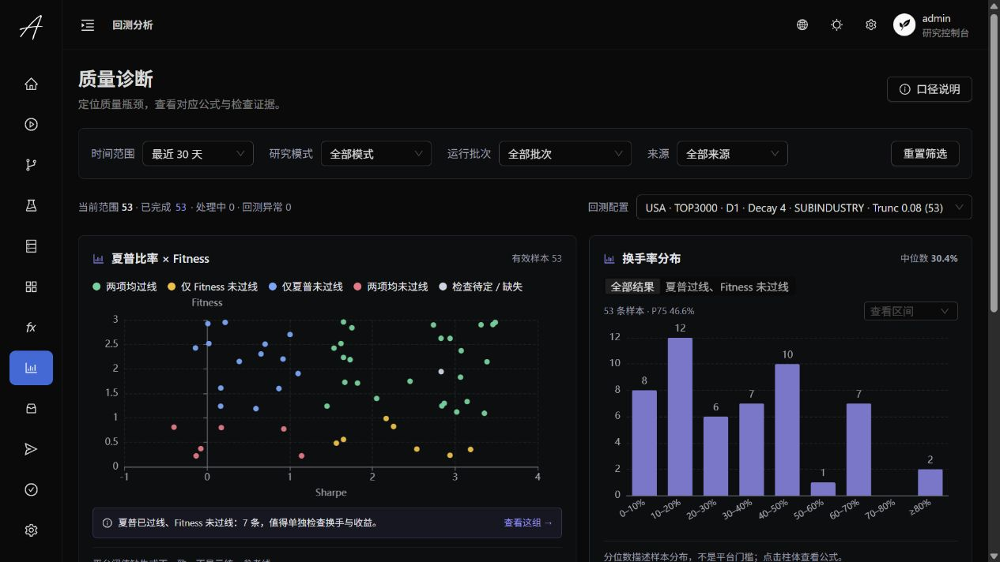
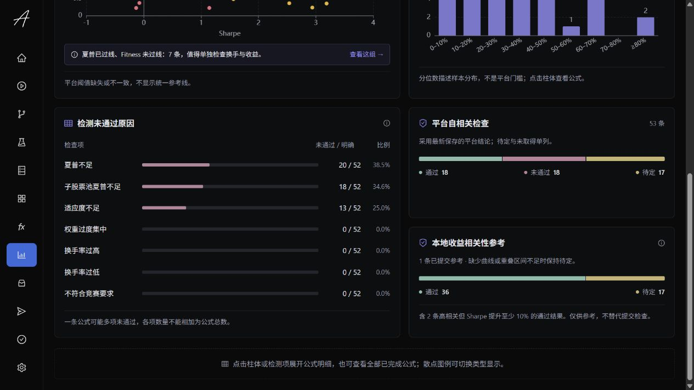
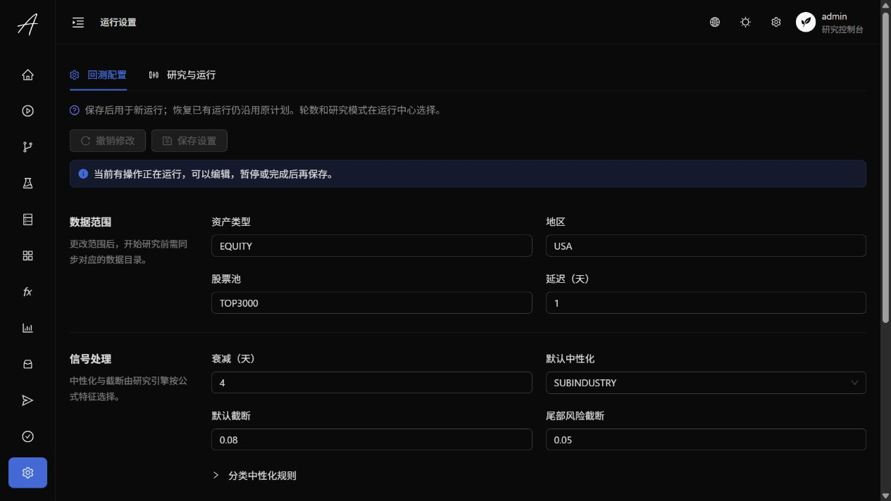

# Alpha Garden

**让公式成为可观察、可改进、可积累的研究资产。**

[English](README.md) · **简体中文**

Alpha Garden 是面向 **WorldQuant BRAIN** 的本地公式研究工作台：Python 研究引擎负责批量探索、变异、回测与检查，中英文网页控制台负责查看和操作。你设定预算和边界，系统在无人值守下持续产出公式，重点控制自相关性（SC），并优先提交高评级结果。

**Python · React · TypeScript · Ant Design · ECharts · SQLite**

[功能](#功能) · [快速开始](#快速开始) · [研究流程](#研究流程) · [常用命令](#常用命令) · [开发](#开发) · [更多文档](#更多文档)



> 时序与年度检查截图使用经授权的已保存平台回测数据（隐去公式标识）；其他界面中的表达式、父子关系和日志均为合成示例。

## 功能

| 工作区 | 可以做什么 |
| --- | --- |
| **工作台** | 近 15 天回测趋势、评级分布、剩余优化机会、批次进度。 |
| **运行中心** | 启动普通回测或专项优化，设轮数，看实时日志，暂停与恢复。 |
| **种子池与专项优化** | 查看种子和研究分支、父子关系与剩余变异机会。 |
| **公式库** | 查询已回测公式、评级与检查结果，打开详情。 |
| **回测分析** | 按 Sharpe / Fitness、换手、未通过检查和相关性定位问题。 |
| **合格归档与提交** | 按单条、按评级，或「全部评级（从高到低）」提交。 |
| **数据目录与算子库** | 检索已同步的字段与算子。 |
| **运行设置** | 编辑回测参数、研究比例、预算、并发和故障边界。 |

<details>
<summary>查看更多界面截图</summary>










</details>

## 快速开始

需要 **Python 3.11+**、**Node.js 24 + pnpm 11** 和一个 **WorldQuant BRAIN 账号**。以下命令在仓库根目录用 PowerShell 执行。

**1. 安装并配置**

```powershell
python -m pip install --no-deps -e .
if (-not (Test-Path .env)) { Copy-Item .env.example .env }
```

参照 [.env.example](.env.example) 填写 `WQB_ACCOUNT_SCOPE` 和认证信息。不要把凭据提交到 Git。默认参数见 [config/](config/)。

**2. 初始化并同步已提交公式**

```powershell
alpha-garden init             # 建库并同步字段、算子（中断后重跑可接续）
alpha-garden sync-submitted   # 建立已提交公式与 PnL 基线，SC 比较依赖它
```

**3. 构建并打开控制台**

```powershell
pnpm --dir webui install --frozen-lockfile
pnpm --dir webui build
alpha-garden web              # 只看数据可加 --read-only
```

打开 <http://127.0.0.1:8787>，用本地控制台账号 `admin` / `123123` 登录（与 WorldQuant 账号无关，仅监听本机）。

**4. 开始研究**

在**运行设置**确认预算 → 在**运行中心**选择普通回测或专项优化并开始 → 在**公式库 / 回测分析**查看结果 → 在**合格归档与提交**中提交。网页启动的运行**不会自动提交**；关闭浏览器不会停止运行，用暂停按钮在安全边界停下，之后可恢复。

## 研究流程

```text
探索（想法模板 + 随机）→ 合格公式入种子池 → 变异 / 组合增强 → 专项优化
→ 本地入队检查 → 按评级从高到低提交（提交前平台复检）
```

- **探索**：大部分探索名额来自 27 个想法模板（7 大类），其余随机生成。
- **种子与谱系**：独立的合格公式成为种子，后代沿谱系继续研究；每条公式最多 20 次变异机会，每个根谱系的质量研究累计最多 80 次。
- **变异与诊断**：先判断父代短板（换手、收益、夏普），再优先使用对应的变异方式。
- **组合增强**：给合格父代叠加一个低相关的补充信号，按最优夏普配比加权。
- **SC 控制**：入种子池、选补充信号、入队和提交都按平台口径（相关 ≥0.7 且夏普未高出 10% 即失败）在本地比较。
- **提交**：评级 → 综合分 → 夏普排序；同一谱系只提交峰顶公式。

完整规则见 [研究规则](docs/research-rules.zh-CN.md)。

## 常用命令

| 操作 | 命令 |
| --- | --- |
| 运行一轮 / 连续五轮 | `alpha-garden run` / `alpha-garden run 5` |
| 专项优化合格公式 | `alpha-garden run -opt` |
| 恢复已有运行 | `alpha-garden resume <run_id>` |
| 从 Spectacular 队列成功提交两条 | `alpha-garden submit 2` |
| 按等级提交两条 | `alpha-garden submit good 2` |
| 同步已提交公式与 PnL | `alpha-garden sync-submitted` |
| 只更新算子目录 | `alpha-garden sync-operators` |
| 查看一次运行的研究反馈 | `alpha-garden research-status <run_id>` |
| 查看本地容量 | `alpha-garden storage inspect` |
| 打开控制台 | `alpha-garden web` |

SC 定向研究、数据库升级、限流处理和存储清理预览见 [运维手册](docs/operations.zh-CN.md)。

## 开发

研究记录保存在 `data/alpha_garden.sqlite3`，账号配置在 `.env`；凭据、数据库、日志和已提交公式清单都不进 Git。

| 内容 | 位置 |
| --- | --- |
| 研究引擎、平台客户端、网页接口 | [src/](src/) |
| React 前端 | [webui/](webui/README.md) |
| 默认配置 | [config/](config/) |
| 测试 | [tests/](tests/) |

前端开发时开两个终端：

```powershell
alpha-garden web --read-only   # 终端 1
pnpm --dir webui dev           # 终端 2，打开 http://127.0.0.1:5173
```

## 更多文档

- [研究规则](docs/research-rules.zh-CN.md)：探索、种子、变异、组合增强、SC 治理与提交顺序。
- [运维手册](docs/operations.zh-CN.md)：目录同步、运行与恢复、SC 定向研究、数据库升级、限流与存储。
- [架构](docs/architecture.zh-CN.md)：模块职责、主流程与数据所有权。
- [前端开发说明](webui/README.md)

## 许可证

[MIT](LICENSE)。项目按现状提供，不保证持续维护或技术支持。
